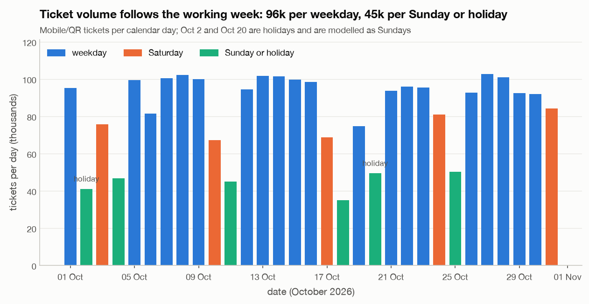
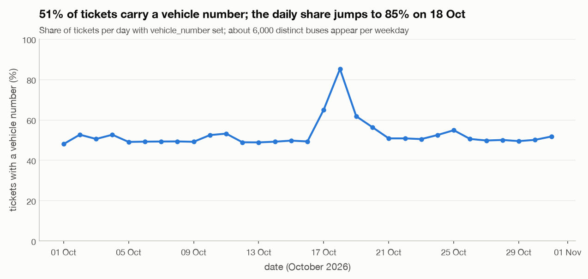
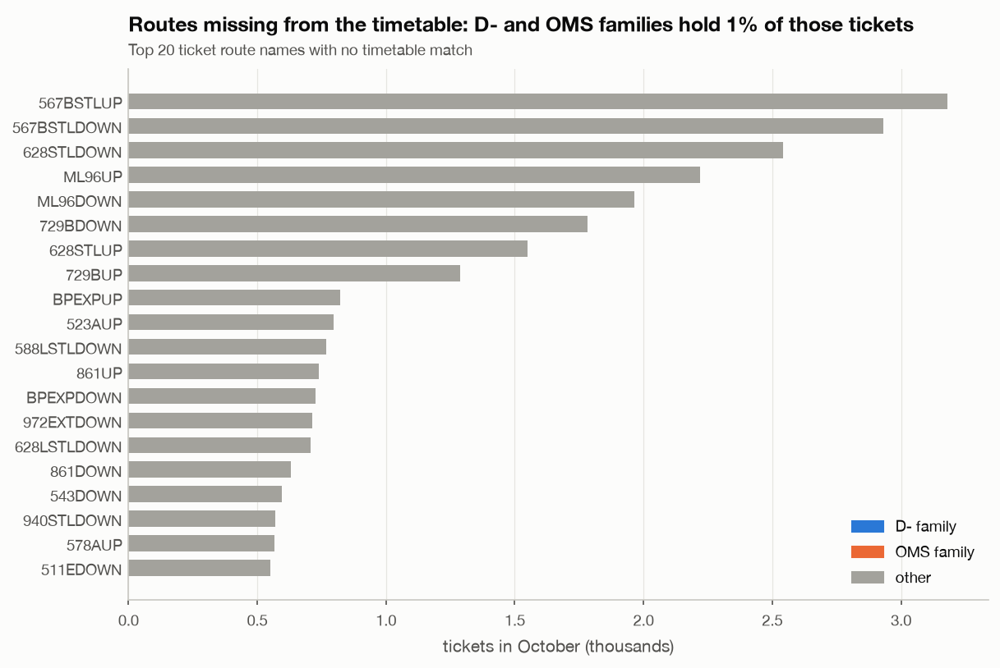

# Data audit

Source: `data/raw/tickets/October-Delhi.csv` (2,559,899 rows, 2,753,606 passengers), matched by the
pipeline to the static timetable, feed v32 (run `full`, Oct 1-31 2026).

## What the file is

- Every row has `ticket_type_id` = 1 (1 distinct value), and
  99.3% of tickets have a fare per passenger of Rs 4.5 / 9 / 13.5 / 18 / 22.5, i.e. the
  regular fares with a 10% discount. This is the digital (mobile/QR) ticket channel only, not all riders.
- Ticketed riders per weekday: 102,303 against an assumed city
  bus ridership of 4 million boardings (low 3M, high 5M). Expansion factor: 39.1
  (low 29.3, high 48.9); about 1 rider in 39 is in the file.
- 80.4% of tickets are on AC buses. 2,259 distinct route names.
- All timestamps carry +05:30 (share without: 0.00%). `created_at` is when the ticket
  was issued; the model uses it as the boarding time.
- 103 tickets have the same boarding and alighting stop name.

## Tickets per day

| daytype | days | tickets/day | passengers/day |
| :--- | ---: | ---: | ---: |
| weekday | 20 | 95,782 | 102,303 |
| sunday | 6 | 44,540 | 50,216 |
| saturday | 5 | 75,405 | 81,251 |

Weekdays average 95,664 tickets in Oct 1-24 (training period) and 96,136 in Oct 25-31
(test week), so the test week is not unusual in volume. Holidays look like Sundays:
2026-10-02: 41,016, 2026-10-20: 49,375. The lowest ordinary weekdays were
2026-10-19 (74,801), 2026-10-06 (81,592), 2026-10-30 (91,896); Oct 19 is the eve of the Oct 20 holiday
and is kept as a weekday.

## Tickets by hour

Weekday purchases peak in the 09:00 hour (13,499 per day) and the
18:00 hour (9,233 per day). 0.11% of tickets are
bought before 04:00, outside the modelled service day.

## Vehicle numbers

Daily share ranges from 48.0% to 85.2%. It is flat near half except for a jump on
2026-10-17 (65.0%), 2026-10-18 (85.2%), 2026-10-19 (61.8%): something in how vehicle
numbers were captured changed for those days (cause unknown from the data). Rebuilt trips and the capture
correction are pooled over all days of a day type, so the jump is diluted in the supply estimate, but it is
one reason bus counts rebuilt from tickets are not comparable day to day (the model's bus counts come from
the timetable and the live feed; rebuilt trips are kept as a sensitivity run).

51.5% of tickets carry a vehicle number (AC 50.2%,
non-AC 56.8%); 6,809 distinct vehicles appear in the month,
about 6,000 per weekday. The pipeline rebuilds 604,775 bus trips from them, with
2.04 tagged tickets per trip on average, which is too few to read a load off a single trip. Loads
are therefore estimated by pooling running counts over all buses in a 30-minute bin.

## Passengers per ticket

| passenger_count | tickets | share | pax |
| ---: | ---: | ---: | ---: |
| 1 | 2,392,082 | 93.4% | 2,392,082 |
| 2 | 141,930 | 5.5% | 283,860 |
| 3 | 25,886 | 1.0% | 77,658 |
| 6 | 1 | 0.0% | 6 |

## Fares

| bus | fare_per_pax | tickets | share |
| :--- | ---: | ---: | ---: |
| AC | 9 | 838,086 | 32.7% |
| AC | 13.5 | 690,561 | 27.0% |
| AC | 18 | 274,722 | 10.7% |
| AC | 22.5 | 237,865 | 9.3% |
| non-AC | 4.5 | 189,711 | 7.4% |
| non-AC | 9 | 188,353 | 7.4% |
| non-AC | 13.5 | 122,741 | 4.8% |
| AC | 26.5 | 6,441 | 0.3% |
| AC | 22 | 4,656 | 0.2% |
| AC | 31 | 1,721 | 0.1% |
| AC | 13 | 1,597 | 0.1% |
| AC | 35.5 | 1,120 | 0.0% |

## Trip length against fare

Only tickets with both stops matched are used (imputed alighting stops take their distance from the fare, so
they would make this check circular). Distances are the model's straight-line distances between consecutive
stops, which run slightly short of road distance.

| bus | fare (Rs/pax) | tickets | p25 km | median km | p75 km | assumed stage km | share in stage |
| :--- | ---: | ---: | ---: | ---: | ---: | :--- | ---: |
| non-AC | 4.5 | 173,013 | 2.0 | 2.8 | 3.6 | 0-4 | 84.6% |
| non-AC | 9 | 172,533 | 5.4 | 6.8 | 8.2 | 4-10 | 87.3% |
| non-AC | 13.5 | 115,531 | 12.1 | 15.9 | 22.1 | 10- | 89.6% |
| AC | 9 | 744,201 | 2.1 | 2.8 | 3.6 | 0-4 | 83.1% |
| AC | 13.5 | 605,692 | 4.9 | 5.9 | 6.9 | 4-8 | 80.7% |
| AC | 18 | 242,205 | 8.0 | 9.2 | 10.4 | 8-12 | 70.0% |
| AC | 22.5 | 207,177 | 13.2 | 16.3 | 20.9 | 12- | 85.6% |

Median trip length rises with every fare step for both bus types (monotonic: yes), and
82.1% of matched tickets fall inside the distance stage that their fare implies
(assumed stages: non-AC Rs 5 up to 4 km, Rs 10 for 4-10 km, Rs 15 beyond; AC Rs 10 / 15 / 20 / 25 for
0-4 / 4-8 / 8-12 / 12+ km, full fares before the 10% discount). Stop matching that was wrong would scatter
trip lengths independently of the fare; it does not. The non-AC Rs 13.5 and AC Rs 22.5 bands are open-ended,
which is why their spread is wide.

## Match outcome

| outcome | tickets | share |
| :--- | ---: | ---: |
| both stops matched | 2,273,707 | 88.8% |
| matched after flipping direction | 3,873 | 0.2% |
| boarding stop matched, alighting imputed | 113,377 | 4.4% |
| route not in the timetable | 42,417 | 1.7% |
| boarding stop not found on route | 126,525 | 4.9% |

Of the matched tickets, 3.6% needed the geographic fallback (a same-named
stop within 400 m of a stop on the route).

## Routes missing from the timetable

Ticket route names that never matched (approximation of "route not in timetable": 42,446 tickets):

| family | tickets | routes | share |
| :--- | ---: | ---: | ---: |
| other | 42,068 | 269 | 99.1% |
| D- family | 378 | 11 | 0.9% |

The D- and OMS families make up 0.9% of these tickets; the rest are 269
other names, led by 567BSTLUP, 567BSTLDOWN, 628STLDOWN, ML96UP, ML96DOWN, which the
feed does not list under those names. Their riders are not placed on any route: no crowding estimate
exists for those buses, and the corridors they serve look emptier than they are.

## Index check

The model's ticket index matches the CSV row order for 100.00% of matched tickets (route name
compared), so raw rows and model outputs can be joined safely.
