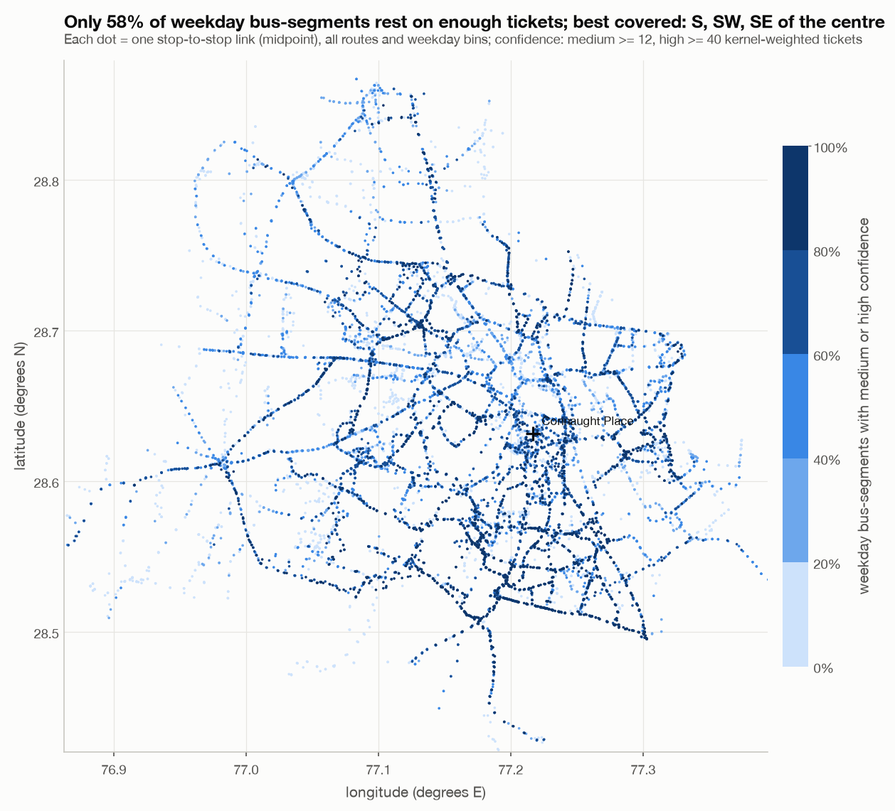

# Coverage: where estimates are least reliable

A cell's confidence is set by the kernel-weighted number of ticketed riders behind it: high >=
40, medium >= 12, otherwise low (summed over all days of
the day type in October). Low-confidence cells are mostly the prior: the route's level and the city-wide
time-of-day shape. Shares below are of bus-segments (each bus passing each segment once).

## By day type

| daytype | high | medium | low |
| :--- | ---: | ---: | ---: |
| weekday | 27.2% | 31.3% | 41.5% |
| saturday | 2.8% | 17.7% | 79.6% |
| sunday | 1.2% | 12.3% | 86.5% |

Weekends rest on 5 Saturdays and 6 Sundays/holidays and far fewer
tickets per day, so 79.6% of Saturday and 86.5% of Sunday bus-segments are low confidence.
Weekend crowding should be shown as indicative only.

## Weekday, by time band

| band | bus_segments | high | medium | low | tickets_per_bus_segment |
| :--- | ---: | ---: | ---: | ---: | ---: |
| early 04:00-08:00 | 124,130 | 18.4% | 30.1% | 51.5% | 0.759 |
| AM peak 08:00-10:00 | 211,810 | 47.5% | 27.4% | 25.1% | 1.361 |
| midday 10:00-17:30 | 493,456 | 19.5% | 33.2% | 47.3% | 0.674 |
| PM peak 17:30-20:00 | 213,238 | 34.4% | 31.7% | 33.9% | 1.045 |
| late 20:00-24:00 | 179,417 | 22.0% | 31.1% | 46.9% | 0.809 |

`tickets_per_bus_segment` = ticketed riders crossing per bus pass per weekday. Among bins with at least a
quarter of the peak bus count, the least covered are 06:00 (63.0% low), 14:00 (62.1% low), 13:30 (61.1% low), 14:30 (60.0% low), 13:00 (59.8% low);
the best covered are 09:00 (22.5% low), 09:30 (23.7% low), 08:30 (24.8% low). Early morning,
midday and late evening estimates lean on the prior; the peaks are where the data is.

## Where

Share of weekday bus-segments with medium or high confidence, by distance and direction from Connaught Place:

| ring | bus_segments | reliable | tickets_per_bus_segment |
| :--- | ---: | ---: | ---: |
| 0-5 km | 185,844 | 53.5% | 0.809 |
| 5-10 km | 405,202 | 62.1% | 0.894 |
| 10-20 km | 509,832 | 62.0% | 0.989 |
| 20+ km | 121,173 | 39.4% | 0.548 |

| sector | bus_segments | reliable | tickets_per_bus_segment |
| :--- | ---: | ---: | ---: |
| N | 107,963 | 44.8% | 0.664 |
| NE | 88,271 | 47.1% | 0.598 |
| E | 93,818 | 60.9% | 0.857 |
| SE | 100,724 | 69.9% | 1.156 |
| S | 156,130 | 76.7% | 1.386 |
| SW | 111,427 | 71.7% | 1.302 |
| W | 254,200 | 52.4% | 0.708 |
| NW | 309,517 | 53.2% | 0.712 |

| ring | N | NE | E | SE | S | SW | W | NW |
| :--- | ---: | ---: | ---: | ---: | ---: | ---: | ---: | ---: |
| 0-5 km | 33.9% | 46.2% | 63.1% | 67.6% | 65.8% | 57.9% | 60.9% | 52.4% |
| 5-10 km | 45.6% | 49.9% | 66.0% | 71.7% | 74.0% | 71.7% | 66.5% | 55.0% |
| 10-20 km | 57.4% | 44.0% | 44.9% | 70.4% | 81.9% | 79.5% | 51.2% | 59.2% |
| 20+ km | 55.9% |  |  | 31.5% | 49.5% | 62.2% | 41.4% | 32.8% |

The S, SW, SE sectors are best covered; the N, NE, W sectors are worst. Coverage also thins
beyond 20 km (39.4% reliable) and in the central 5 km
(53.5%), where ticketed riders per bus pass are also lower
(0.809 against
0.989 in the best ring). Confidence is per route, so a central corridor
served by several lightly ticketed routes can be busy overall while each route's cells stay low confidence.

### Least reliable busy areas

2 km grid cells in the top 30% by weekday bus-segments, ranked by the share of their bus-segments with
medium or high confidence (lowest first). 0 of 101 busy grid cells
have no medium- or high-confidence bus-segment at all.

| area_stop | where | routes | bus_segments | reliable | tickets_per_bus_segment |
| :--- | :--- | ---: | ---: | ---: | ---: |
| Om Vihar | 16 km W of CP | 74 | 6,325 | 20.2% | 0.344 |
| Narela Terminal | 27 km NW of CP | 69 | 5,692 | 25.5% | 0.370 |
| Ice Factory (Rani Jhansi Road) | 4 km N of CP | 162 | 13,773 | 26.1% | 0.339 |
| Telephone Exchange | 7 km N of CP | 96 | 10,003 | 26.5% | 0.362 |
| B2A Janakpuri | 12 km W of CP | 156 | 9,035 | 31.7% | 0.435 |
| ISBT Nityanand Marg | 4 km N of CP | 315 | 22,041 | 34.9% | 0.507 |
| Nanak Piyau | 24 km W of CP | 137 | 7,825 | 35.6% | 0.558 |
| NajafGarh Delhi Gate | 22 km W of CP | 152 | 14,232 | 40.1% | 0.499 |
| Bank Colony | 12 km NE of CP | 69 | 8,477 | 40.6% | 0.457 |
| B-Block Yamuna Vihar | 10 km NE of CP | 71 | 5,649 | 41.0% | 0.462 |
| Dholi Piao | 14 km W of CP | 182 | 15,297 | 42.9% | 0.467 |
| Model Town II | 9 km N of CP | 159 | 9,113 | 44.0% | 0.519 |

In words: the weakest areas are places with plenty of buses but few app tickets, named here by their
busiest stop: Om Vihar (16 km W of CP); Narela Terminal (27 km NW of CP); Ice Factory (Rani Jhansi Road) (4 km N of CP); Telephone Exchange (7 km N of CP); B2A Janakpuri (12 km W of CP); ISBT Nityanand Marg (4 km N of CP); Nanak Piyau (24 km W of CP); NajafGarh Delhi Gate (22 km W of CP).

## Problems the confidence label does not capture

1. **Riders the model cannot place.** 12.8% of tickets are on routes missing
   from the 2025 timetable and 9.5% have a boarding stop not found on their route.
   Those buses have no estimate at all, and corridors shared with them look emptier than they are. Another
   9.0% of tickets have an imputed alighting stop. 637 of
   2,403 timetable patterns have no matched ticket.
2. **Duplicate route names.** In the timetable, 421 route names exist twice, and
   421 of those pairs belong to two different operators. 27 such names carry tickets,
   covering 4.5% of weekday bus-segments. Tickets from one physical bus can be
   matched to either copy. Of 247,661 rebuilt trips on such routes,
   7,257 (2.9%) have a trip by the same vehicle on the sibling
   `route_id` starting within an hour (5,290 within 30 minutes). Rebuilt trips on one
   `route_id` are split only after a 90-minute gap, so a same-direction twin within the hour is very likely
   the same journey counted twice (short routes could produce some genuine pairs). Ticket-based supply on these routes is therefore inflated, which pushes their loads
   down; each copy also gets only part of the tickets.
3. **Capture correction not identified.** On 69 routes nearly every rebuilt trip
   carries a single tagged ticket, so the number of unseen trips is not identified and the correction sits at
   its cap of 3x (2.2% of weekday bus-segments).
4. **Supply comes from the tickets in much of the network.** In 39.7% of weekday bus-segments the
   ticket-based bus count exceeds the timetable and is used instead; 19.7% of bus-segments are in
   bins where the 2025 timetable has no bus at all. Where the observed count is too low (few tagged tickets),
   the per-bus load is too high.
5. **Implausible loads with high confidence.** 0 weekday cells exceed crush capacity,
   0 of them "high confidence" (on 0 routes); 0 of the
   over-crush cells are in bins with no timetabled bus. Confidence counts tickets, not the reliability of the
   bus count they are divided by, so a confidence label should be read together with the supply source.
