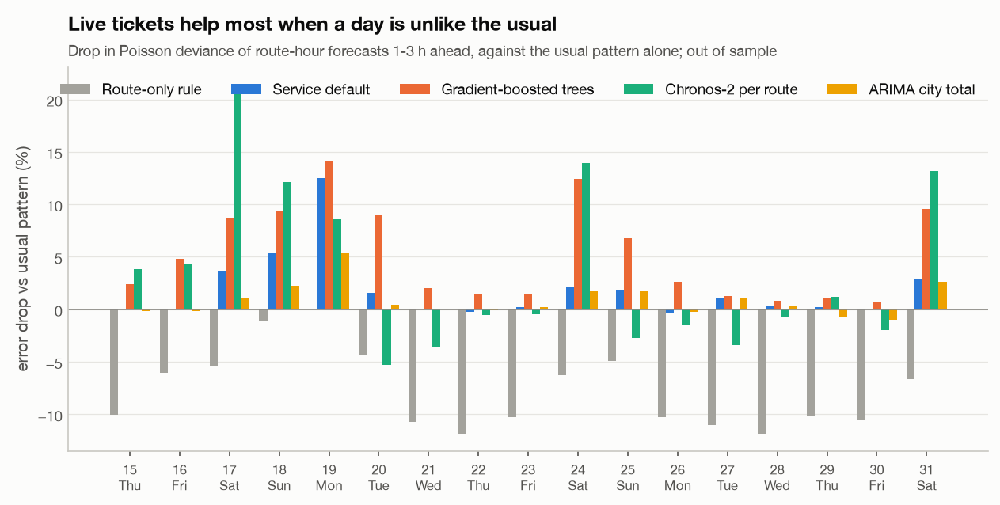
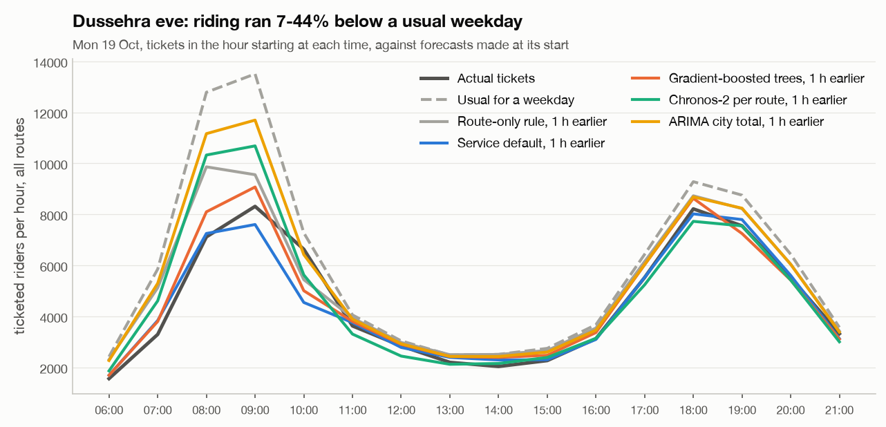

# Live adjustment: does it forecast the next hours better?

The service scales each route's usual riding by how busy the city, and the route, have been in the last
hour (technical note 2.9). This replays October hour by hour and scores that rule and the alternatives
against what happened.

**Setup.** Every route's ticketed riders per hour. "Usual" for a day is the average of the earlier days of
its day type, so it is never fitted on the day it forecasts. At every hour from 06:00 to 21:00 on Oct 15-31
(17 days), each method forecasts each route's riders for the next three hours from the tickets so far:
1,507,392 route-hour forecasts. Settings are tuned on Oct 15-24 and scored on Oct 25-31, and the
other way round, so every score is out of sample. Chronos rows come from `nowcast_chronos.py` (amazon/chronos-bolt-small and amazon/chronos-2, chronos-forecasting 2.3.2, two weeks of hourly history, forecast = mean of the 0.1-0.9 quantiles, no training on Delhi data). ARIMA rows come from `nowcast_arima.py` (statsmodels 0.15.0 SARIMAX, log(1 + riders) on log(1 + usual) with ARMA errors, two weeks of hourly history, refitted at every forecast time; city orders chosen: (1, 0, 0) x83, (1, 0, 1) x187, (2, 0, 0) x2).

**Scores.** Poisson deviance per route-hour (lower is better; the right error for small counts). Gain is
its drop against the usual pattern alone. MAE is in riders per route-hour. "City total error" is the
average error of the city's total for each forecast hour; "Total / actual" is the bias of the total.
Busy routes are route-hours where at least 10 ticketed riders are usual. Oct 18-20 are the days around
Dussehra.

| Method | Deviance | Gain | Gain, busy routes | Gain, Oct 18-20 | Gain, other days | MAE | City total error | Total / actual |
| :--- | ---: | :--- | :--- | :--- | :--- | ---: | :--- | ---: |
| Usual pattern only | 1.379 | 0.0% | 0.0% | 0.0% | 0.0% | 1.25 | 12.3% | 1.009 |
| Route-only rule (last hour, 6 pseudo-tickets) | 1.484 | -7.6% | -31.9% | -1.8% | -8.8% | 1.35 | 9.9% | 1.014 |
| Route-only rule, tuned | 1.366 | 1.0% | 1.5% | 2.4% | 0.6% | 1.24 | 10.8% | 1.010 |
| City ratio only, tuned | 1.353 | 1.9% | 5.8% | 6.6% | 0.9% | 1.23 | 8.1% | 1.004 |
| City ratio nudged by the route (service default) | 1.352 | 2.0% | 6.0% | 6.7% | 0.9% | 1.23 | 8.1% | 1.004 |
| Gradient-boosted trees, no live tickets | 1.353 | 1.9% | -1.9% | 2.1% | 1.8% | 1.26 | 13.3% | 1.020 |
| Gradient-boosted trees on today's tickets | 1.304 | 5.5% | 6.8% | 10.9% | 4.3% | 1.22 | 9.8% | 1.000 |
| ARIMA on the city total x usual pattern | 1.367 | 0.9% | 2.3% | 2.8% | 0.5% | 1.24 | 10.0% | 1.001 |
| ARIMA per route, usual pattern as regressor | 1.416 | -2.7% | -5.3% | 3.7% | -4.0% | 1.23 | 14.2% | 0.880 |
| Chronos-Bolt per route (pretrained, no profile) | 1.432 | -3.8% | -8.9% | -2.7% | -4.0% | 1.26 | 15.9% | 0.951 |
| Chronos-2 per route, usual pattern as covariate | 1.325 | 4.0% | 4.3% | 4.9% | 3.8% | 1.20 | 11.8% | 0.967 |
| Chronos-2 on the city total x usual pattern | 1.373 | 0.5% | 1.6% | -0.4% | 0.6% | 1.25 | 10.6% | 1.024 |

## Gain by hours ahead
| Method | 1 h ahead | 2 h ahead | 3 h ahead |
| :--- | :--- | :--- | :--- |
| Route-only rule (last hour, 6 pseudo-tickets) | -6.8% | -8.5% | -7.5% |
| Route-only rule, tuned | 1.1% | 0.9% | 0.9% |
| City ratio only, tuned | 2.6% | 1.8% | 1.3% |
| City ratio nudged by the route (service default) | 2.7% | 1.9% | 1.3% |
| Gradient-boosted trees, no live tickets | 1.9% | 1.9% | 1.9% |
| Gradient-boosted trees on today's tickets | 6.8% | 5.3% | 4.3% |
| ARIMA on the city total x usual pattern | 1.6% | 0.7% | 0.4% |
| ARIMA per route, usual pattern as regressor | -1.7% | -3.0% | -3.3% |
| Chronos-Bolt per route (pretrained, no profile) | -2.3% | -4.0% | -5.1% |
| Chronos-2 per route, usual pattern as covariate | 5.1% | 3.7% | 3.2% |
| Chronos-2 on the city total x usual pattern | 1.8% | 0.3% | -0.7% |

## Settings chosen
| Method | Tuned on | Settings |
| :--- | :--- | :--- |
| Route-only rule, tuned | tuned on Oct 15-24 | since 04:00; 25 pseudo-tickets toward 1; clamp 0.25-4; fades x0.7 per hour |
| Route-only rule, tuned | tuned on Oct 25-31 | since 04:00; 100 pseudo-tickets toward 1; clamp 0.5-2.5; fades x0.85 per hour |
| Route-only rule, tuned | tuned on all days | since 04:00; 40 pseudo-tickets toward 1; clamp 0.25-4; fades x0.7 per hour |
| City ratio only, tuned | tuned on Oct 15-24 | last 1 h; city ratio only; clamp 0.67-1.5; fades x0.85 per hour |
| City ratio only, tuned | tuned on Oct 25-31 | last 1 h; city ratio only; clamp 0.5-2.5; fades x0.7 per hour |
| City ratio only, tuned | tuned on all days | last 1 h; city ratio only; clamp 0.67-1.5; fades x0.85 per hour |
| City ratio nudged by the route (service default) | tuned on Oct 15-24 | last 1 h; 200 pseudo-tickets toward the city ratio; clamp 0.67-1.5; fades x0.85 per hour |
| City ratio nudged by the route (service default) | tuned on Oct 25-31 | last 1 h; 400 pseudo-tickets toward the city ratio; clamp 0.5-2.5; fades x0.7 per hour |
| City ratio nudged by the route (service default) | tuned on all days | last 1 h; 200 pseudo-tickets toward the city ratio; clamp 0.67-1.5; fades x0.85 per hour |

## The days around Dussehra
| Day | City tickets vs usual, 08:00-09:00 | 17:00-18:00 |
| :--- | :--- | :--- |
| 2026-10-18 (Sunday before Dussehra) | 0.78 | 0.84 |
| 2026-10-19 (Monday, Dussehra eve) | 0.56 | 0.86 |
| 2026-10-20 (Dussehra (holiday)) | 1.28 | 1.52 |

## Reading the results
See the technical note, section 5, for the interpretation and how the statistical rule compares with the models.
