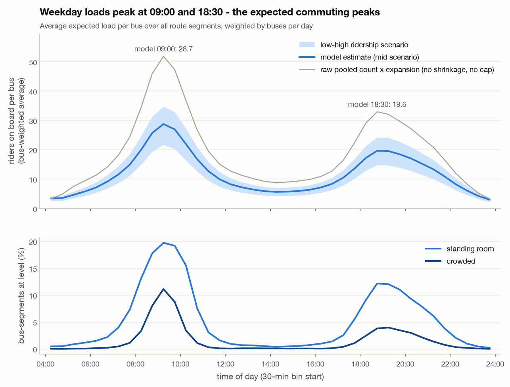
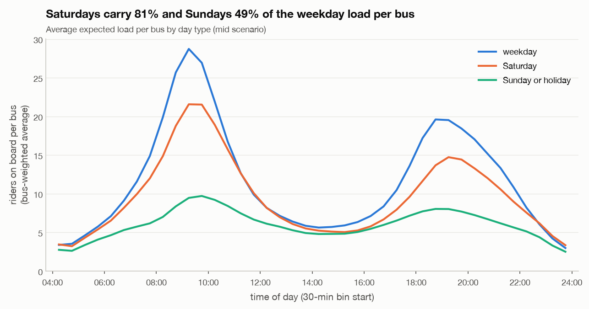
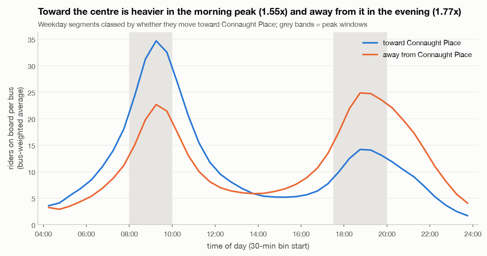

# Known-pattern checks

Model run `full` (Oct 1-31 2026, 20 weekdays, 5 Saturdays,
6 Sundays and holidays). "Load" is expected riders on board per bus on a stop-to-stop
segment in a 30-minute bin (mid ridership scenario); averages are weighted by buses per day so a busy
corridor counts more than a route with one trip. Shares of "bus-segments" count each bus passing each
segment once.

## 1. Time of day (weekday)

- Morning peak: **09:00** bin, average load 28.7 per bus
  (30.8% of bus-segments standing or crowded).
- Evening peak: **18:30** bin, average load 19.6
  (15.9% standing or crowded).
- Midday trough: 14:00 bin, 5.6 per bus.
- Expected: AM peak around 08:00-10:00 and PM peak around 17:00-20:00. Result:
  **consistent**. The morning peak is
  1.47 times the evening peak; the evening peak is lower and broader, as in the
  raw ticket purchase times (see audit).
- The grey line is the raw pooled ticket count per bus pass times the expansion factor, without
  shrinkage or the per-route capacity cap. Its peaks fall in the same bins (09:00,
  18:30), so the shape comes from the data, not from the smoothing. The model sits
  below the raw line at the peaks (28.7 vs 51.8 in the AM peak bin of each);
  without the per-route capacity cap (run `sens_nocap`) the AM peak bin averages 38.5, so most of
  the gap is the cap lowering 841 routes' expansion, not the shrinkage.

## 2. Weekday vs Saturday vs Sunday

| day type | mean load per bus | peak bin | peak load | bus-segments not 'seats' |
| :--- | ---: | :--- | ---: | ---: |
| weekday | 13.2 | 09:00 | 28.7 | 8.1% |
| saturday | 10.7 | 09:00 | 21.6 | 3.9% |
| sunday | 6.5 | 09:30 | 9.7 | 0.3% |

Saturday loads are 81% and Sunday/holiday loads 49% of weekday loads per bus. Bus supply in
the model barely changes at weekends (Saturday 100% and Sunday 100% of weekday bus-segments),
so per-bus loads fall roughly in line with ticket volume. One caveat: the same expansion factor, set from
weekday ridership, is applied to weekends, which assumes the share of riders using mobile tickets does not
change at weekends. Weekend estimates also rest on only 5 Saturdays and
6 Sundays/holidays, so most weekend cells are low confidence (see coverage).

## 3. Direction relative to Connaught Place

Each segment is "inbound" if its to-stop is closer to Connaught Place (28.6315, 77.2167) than its from-stop
(straight-line distance from GTFS stop coordinates), otherwise "outbound". Peak windows: AM
08:00-10:00, PM 17:30-20:00.

| segments | window | inbound load | outbound load | in/out load ratio | in/out passenger-km ratio |
| :--- | :--- | ---: | ---: | ---: | ---: |
| all segments | AM | 30.6 | 19.8 | 1.55 | 1.63 |
| all segments | PM | 12.7 | 22.5 | 0.57 | 0.56 |
| all segments | all day | 13.0 | 13.4 | 0.97 | 1.00 |
| mostly radial segments | AM | 31.5 | 18.3 | 1.72 | 1.83 |
| mostly radial segments | PM | 11.1 | 23.4 | 0.48 | 0.45 |

By distance of the segment from Connaught Place (in/out ratios, weekday):

| distance from CP | AM in/out load | AM in/out pass-km | PM in/out load | PM in/out pass-km |
| :--- | ---: | ---: | ---: | ---: |
| 0-5 km | 1.73 | 1.85 | 0.53 | 0.50 |
| 5-10 km | 1.52 | 1.60 | 0.62 | 0.62 |
| 10-20 km | 1.56 | 1.64 | 0.53 | 0.55 |
| 20+ km | 1.29 | 1.42 | 0.54 | 0.49 |

Expected: inbound heavier in the AM peak, outbound heavier in the PM peak. Result:
**consistent** (AM in/out ratio 1.55 (passenger-km 1.63),
PM 0.57 (passenger-km 0.56)). "Mostly radial" keeps segments whose change in distance to
CP is at least half their length; the asymmetry is stronger on them, as it should be if it reflects
travel to and from the centre. By distance ring, the AM ratio is above 1 and the PM ratio below 1 in
4 of 4 rings; the AM asymmetry is strongest in the 0-5 km ring and weakest in the
20+ km ring, where trips to other centres (Gurugram, Noida, Okhla) matter more.

## 4. Busiest corridors and stops

### Top 15 stop-to-stop links by weekday passengers through per day (all routes combined)

| from_stop_name | to_stop_name | routes | buses_per_day | passengers_per_day | avg_load | peak_bin_load |
| :--- | :--- | ---: | ---: | ---: | ---: | ---: |
| Rainy Well | Delhi Secretariat | 47 | 1,871 | 42,816 | 22.9 | 71.5 |
| Delhi Secretariat | Rainy Well | 46 | 1,800 | 40,096 | 22.3 | 58.8 |
| Shivaji Park | Maharaja Agrasen Hospital | 70 | 2,426 | 36,129 | 14.9 | 53.5 |
| SPM College | Shivaji Park | 69 | 2,409 | 36,073 | 15.0 | 54.9 |
| Madipur Village / CARI / P B Enclave | SPM College | 69 | 2,409 | 35,501 | 14.7 | 54.7 |
| South Patel Nagar (Metro Station) / South Patel Nagar Block 43 , 45 | East Patel Nagar | 52 | 1,718 | 35,142 | 20.5 | 52.1 |
| Madipur JJ Colony /  Madipuri Metro Station | Madipur Village / CARI / P B Enclave | 69 | 2,417 | 34,668 | 14.3 | 53.2 |
| Ordinance Depot | Madipur JJ Colony /  Madipuri Metro Station | 68 | 2,380 | 34,316 | 14.4 | 52.3 |
| West Patel Nagar / Patel Nagar | South Patel Nagar (Metro Station) / South Patel Nagar Block 43 , 45 | 52 | 1,718 | 33,915 | 19.7 | 52.1 |
| Shivaji Park | SPM College | 69 | 2,299 | 33,693 | 14.7 | 32.3 |
| Multan Nagar | New Multan Nagar / Avtar Enclave | 64 | 2,292 | 33,691 | 14.7 | 54.0 |
| New Multan Nagar / Avtar Enclave | Ordinance Depot | 65 | 2,291 | 33,508 | 14.6 | 53.2 |
| SPM College | Madipur Village / CARI / P B Enclave | 69 | 2,298 | 33,460 | 14.6 | 32.5 |
| Paschim Vihar (Super market) | Multan Nagar | 60 | 2,251 | 33,252 | 14.8 | 54.5 |
| Madipur Village / CARI / P B Enclave | Madipur JJ Colony / MadiPur Metro Station | 68 | 2,285 | 33,233 | 14.5 | 32.7 |

### Top 15 single-route segments by weekday passengers through per day

| route_id | route_name | from_stop_name | to_stop_name | passengers_per_day | buses_per_day |
| :--- | :--- | :--- | :--- | ---: | ---: |
| 2204 | 729UP | Rajokari Crossing NH8 / Shiv Murti | Samlakha Xing | 6,960 | 144 |
| 2204 | 729UP | Samlakha Xing | Samalkha Village | 6,877 | 144 |
| 2204 | 729UP | Rang Puri (NH8) | Shiv Murti | 6,798 | 144 |
| 2204 | 729UP | Samalkha Village | Kapashera Crossing | 6,581 | 144 |
| 2203 | 729DOWN | Shiv Murti (NH8) | Rang puri (NH8) | 6,543 | 164 |
| 2204 | 729UP | Shiv Murti | Rajokari Xing | 6,477 | 144 |
| 2203 | 729DOWN | Uppal Hotel | Shiv Murti (NH8) | 6,459 | 164 |
| 2229 | 764DOWN | RK Puram Sec 6 | Swami Malai Mandir | 6,429 | 134 |
| 2203 | 729DOWN | Samalkha Crossing | Uppal Hotel | 6,363 | 164 |
| 2229 | 764DOWN | Vasant Vihar / Poorvi Marg RK Puram Sec 5 | RK Puram Sec 6 | 6,327 | 134 |
| 2204 | 729UP | Air Force HQ / Subroto Park | APS Colony/ Jharera Gaon | 6,258 | 145 |
| 2204 | 729UP | RR Hospital / Maharana Pratap Chowk | Air Force HQ / Subroto Park | 6,207 | 145 |
| 2204 | 729UP | Mahipal Pur Village / Mahipal Pur Crossing NH8 | Rang Puri (NH8) | 6,190 | 144 |
| 2203 | 729DOWN | Rang puri (NH8) | Mahipal Pur (NH8) / MAHIPAL PUR CROSSING | 6,168 | 164 |
| 2229 | 764DOWN | Swami Malai Mandir | RAO TULA RAM COLLEGE / Vasant Village / Shani Mandir | 6,145 | 130 |

These are all on 3 route name(s): 729UP, 729DOWN, 764DOWN. One route family dominating the
single-route list is a warning sign, not a finding about Delhi: see the notes below.

### Heaviest peak load per route (top 15 routes, cells with medium or high confidence and at least 1 bus per day)

| route | agency | segment | time | load | level | buses_in_bin | tickets | confidence |
| :--- | :--- | :--- | :--- | ---: | :--- | ---: | ---: | :--- |
| 835DOWN | DTC | Mata Dhankaur Public School -> Rawta Crossing (Dhansa Road) | 08:00 | 90.0 | crowded | 1.3 | 141 | high |
| 182AUP | DTC | Saraswati  Vihar C Block -> Kali Mata Mandir | 19:30 | 90.0 | crowded | 1.1 | 82 | high |
| 174UP | DIMTS | Madhuban Chowk Outer Ring Road -> Saraswati  Vihar C Block | 18:30 | 90.0 | crowded | 2.9 | 198 | high |
| 794UP | DTC | Bhogal (Jungpura) -> Nizamuddin Extension | 09:00 | 90.0 | crowded | 1.2 | 106 | high |
| 835UP | DTC | Mitraon Village -> Mitraon School | 18:30 | 90.0 | crowded | 1.6 | 130 | high |
| 818DOWN | DTC | Roshanpura -> Chhawla Stand Najafgarh | 08:30 | 90.0 | crowded | 1.1 | 80 | high |
| 219DOWN | DTC | Nangloi Depot  / Jwala Puri -> Inder Enclave | 09:30 | 90.0 | crowded | 1.1 | 70 | high |
| 774UP | DIMTS | Lal Kuan -> Prem Nagar (TUGLQABAD ROAD) | 09:00 | 90.0 | crowded | 1.4 | 304 | high |
| 107UP | DIMTS | Rohini Sec 18 B7 Road -> Rohini DTC Depot 4 | 19:00 | 90.0 | crowded | 1.1 | 59 | high |
| 801-IND-IGIUP | DTC | Dada Dev Mandir -> Baghdola Village | 09:30 | 90.0 | crowded | 1.7 | 201 | high |
| 801-IGI-INDDOWN | DTC | Cargo / Express Terminal Gate 6 -> Aero City Metro Station | 06:30 | 90.0 | crowded | 2.5 | 254 | high |
| 937ADOWN | DTC | Sultanpuri Crossing -> Mangol Puri S Block | 08:30 | 90.0 | crowded | 1.0 | 123 | high |
| 818UP | DTC | Najafgarh Delhi Gate -> Chawla Stand Najafgarh | 19:30 | 90.0 | crowded | 1.5 | 81 | high |
| 940DOWN | DTC | Madipur Village / CARI / P B Enclave -> SPM College | 09:30 | 90.0 | crowded | 1.1 | 65 | high |
| 774DOWN | DIMTS | Prehlad Pur ( Palam ) -> Indian Oil Station | 09:00 | 90.0 | crowded | 2.2 | 432 | high |

### Top 15 boarding stops (weekday, expanded boardings per day, all routes)

Stops are grouped by name within about 2 km, so same-named stops in different parts of the city stay apart.

| stop_name | routes | boardings_per_day | ticketed_per_day | where |
| :--- | ---: | ---: | ---: | :--- |
| Hamdard Nagar / Sangam Vihar | 69 | 39,485 | 1,010 | 14 km S of CP |
| Badarpur Border(T) | 19 | 27,294 | 698 | 18 km SE of CP |
| Saket Metro Station | 15 | 26,763 | 684 | 12 km S of CP |
| Mahipal Pur Village | 19 | 26,081 | 667 | 13 km SW of CP |
| West Patel Nagar / Patel Nagar | 111 | 23,703 | 606 | 5 km W of CP |
| Mehrauli Terminal | 38 | 22,946 | 587 | 13 km S of CP |
| Said ul zeb Village | 15 | 20,739 | 530 | 12 km S of CP |
| Badarpur Border (T) | 33 | 19,893 | 509 | 18 km SE of CP |
| ITO AGCR /  ITO | 91 | 19,447 | 497 | 3 km E of CP |
| Ambedkar Nagar Depot | 63 | 18,612 | 476 | 13 km S of CP |
| Kapashera Border | 30 | 18,442 | 472 | 18 km SW of CP |
| SagarPur Vashisht Park | 101 | 18,107 | 463 | 12 km W of CP |
| Punj Sons / Govind Puri Metro Station | 66 | 17,246 | 441 | 11 km SE of CP |
| Munirka Village (T) | 38 | 16,384 | 419 | 9 km SW of CP |
| Mahipal Pur Village / Mahipal Pur Crossing NH8 | 30 | 15,990 | 409 | 13 km SW of CP |

12 of the 15 stops lie in the SE, S or SW sectors as seen from Connaught Place.
4 of the 15 stop names contain a hub word (ISBT, Metro, Terminal, Depot, Station, Railway, Rly). The list is
not checked against counts; it is shown so a reader who knows Delhi can judge it.

## 5. Crowding in the weekday peaks (bus-km)

| window | bus_km | seats | standing | crowded | exp_standing | exp_crowded |
| :--- | ---: | ---: | ---: | ---: | ---: | ---: |
| all day | 1,164,929 | 91.4% | 6.5% | 2.1% | 6.5% | 3.1% |
| AM peak 08:00-10:00 | 154,207 | 73.8% | 17.8% | 8.3% | 15.9% | 10.4% |
| PM peak 17:30-20:00 | 180,365 | 86.3% | 10.4% | 3.3% | 10.0% | 4.9% |
| outside peaks | 830,357 | 95.8% | 3.5% | 0.7% | 4.1% | 1.4% |

`seats/standing/crowded` = share of bus-km whose shown level (the median bus) is that level;
`exp_*` = expected share of bus-km on buses in that state (averaging the per-bus probabilities). Across both
peak windows, 80.6% of bus-km show seats, 13.8% standing and
5.6% crowded.

## 6. Scale and physical sanity

- Expanded weekday boardings in the model: 3,922,768 against the 4,000,000 the expansion targets.
  The gap is the 6.6% of tickets that could not be matched to the timetable: their
  riders are counted in the expansion factor but are not placed on the network, so loads on matched
  routes are not inflated to compensate.
- Weekday bus-km (straight line) 1,164,929; passenger-km 15,734,460; average
  13.5 riders per bus-km.
- 0.00% of weekday bus-segments have an expected load above crush capacity; the
  highest single cell is 90 riders.

## Notes and warnings

- The corridor ranking measures riders who buy mobile tickets, scaled by one city-wide factor. A route
  whose riders use the app more than average ranks higher than its true ridership; the per-route
  capacity cap only corrects the extreme cases. Nothing in this data can separate app adoption from
  ridership, so the ranking should be read as "busiest for app users".
- Route names that appear more than once in the timetable (two `route_id`s with the same name) can split one
  bus's tickets between the copies. Route names in the tables above that have this issue:
  none. See `coverage.md`.
- 0 of the 15 heaviest per-route peaks above exceed crush capacity (85-90), in
  bins with only nan-nan buses per day. These cells are "high confidence" because confidence counts tickets only; a bus count that
  is too low for the bin (timetable or live-feed factor) inflates the per-bus load, and such loads are capped at
  crush. Confidence does not capture supply uncertainty.
