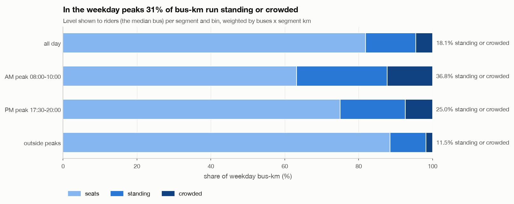

# Known-pattern checks

Model run `full` (Oct 1-31 2026, 20 weekdays, 5 Saturdays,
6 Sundays and holidays). "Load" is expected riders on board per bus on a stop-to-stop
segment in a 30-minute bin (mid ridership scenario); averages are weighted by buses per day so a busy
corridor counts more than a route with one trip. Shares of "bus-segments" count each bus passing each
segment once.

## 1. Time of day (weekday)

- Morning peak: **09:00** bin, average load 35.9 per bus
  (40.1% of bus-segments standing or crowded).
- Evening peak: **19:00** bin, average load 28.9
  (27.6% standing or crowded).
- Midday trough: 13:00 bin, 13.3 per bus.
- Expected: AM peak around 08:00-10:00 and PM peak around 17:00-20:00. Result:
  **consistent**. The morning peak is
  1.24 times the evening peak; the evening peak is lower and broader, as in the
  raw ticket purchase times (see audit).
- The grey line is the raw pooled ticket count per bus pass times the expansion factor, without
  shrinkage or the per-route capacity cap. Its peaks fall in the same bins (09:00,
  19:00), so the shape comes from the data, not from the smoothing. The model sits
  below the raw line at the peaks (35.9 vs 58.2 in the AM peak bin of each);
  without the per-route capacity cap (run `sens_nocap`) the AM peak bin averages 45.8, so most of
  the gap is the cap lowering 645 routes' expansion, not the shrinkage.

## 2. Weekday vs Saturday vs Sunday

| day type | mean load per bus | peak bin | peak load | bus-segments not 'seats' |
| :--- | ---: | :--- | ---: | ---: |
| weekday | 22.9 | 09:00 | 35.9 | 17.4% |
| saturday | 20.6 | 09:00 | 29.0 | 11.3% |
| sunday | 13.1 | 09:00 | 15.1 | 1.5% |

Saturday loads are 90% and Sunday/holiday loads 57% of weekday loads per bus. Bus supply in
the model barely changes at weekends (Saturday 90% and Sunday 86% of weekday bus-segments),
so per-bus loads fall roughly in line with ticket volume. One caveat: the same expansion factor, set from
weekday ridership, is applied to weekends, which assumes the share of riders using mobile tickets does not
change at weekends. Weekend estimates also rest on only 5 Saturdays and
6 Sundays/holidays, so most weekend cells are low confidence (see coverage).

## 3. Direction relative to Connaught Place

Each segment is "inbound" if its to-stop is closer to Connaught Place (28.6315, 77.2167) than its from-stop
(straight-line distance from GTFS stop coordinates), otherwise "outbound". Peak windows: AM
08:00-10:00, PM 17:30-20:00.

| segments | window | inbound load | outbound load | in/out load ratio | in/out passenger-km ratio |
| :--- | :--- | ---: | ---: | ---: | ---: |
| all segments | AM | 38.1 | 27.3 | 1.40 | 1.64 |
| all segments | PM | 20.9 | 32.0 | 0.65 | 0.58 |
| all segments | all day | 23.0 | 22.7 | 1.02 | 1.02 |
| mostly radial segments | AM | 38.7 | 25.4 | 1.52 | 1.89 |
| mostly radial segments | PM | 19.0 | 33.0 | 0.58 | 0.48 |

By distance of the segment from Connaught Place (in/out ratios, weekday):

| distance from CP | AM in/out load | AM in/out pass-km | PM in/out load | PM in/out pass-km |
| :--- | ---: | ---: | ---: | ---: |
| 0-5 km | 1.63 | 1.84 | 0.59 | 0.48 |
| 5-10 km | 1.37 | 1.60 | 0.69 | 0.63 |
| 10-20 km | 1.42 | 1.70 | 0.63 | 0.57 |
| 20+ km | 1.04 | 1.33 | 0.70 | 0.63 |

Expected: inbound heavier in the AM peak, outbound heavier in the PM peak. Result:
**consistent** (AM in/out ratio 1.40 (passenger-km 1.64),
PM 0.65 (passenger-km 0.58)). "Mostly radial" keeps segments whose change in distance to
CP is at least half their length; the asymmetry is stronger on them, as it should be if it reflects
travel to and from the centre. By distance ring, the AM ratio is above 1 and the PM ratio below 1 in
4 of 4 rings; the AM asymmetry is strongest in the 0-5 km ring and weakest in the
20+ km ring, where trips to other centres (Gurugram, Noida, Okhla) matter more.

## 4. Busiest corridors and stops

### Top 15 stop-to-stop links by weekday passengers through per day (all routes combined)

| from_stop_name | to_stop_name | routes | buses_per_day | passengers_per_day | avg_load | peak_bin_load |
| :--- | :--- | ---: | ---: | ---: | ---: | ---: |
| West Patel Nagar | South Patel Nagar (Metro Station) | 55 | 1,382 | 44,994 | 32.6 | 49.8 |
| South Patel Nagar (Metro Station) | East Patel Nagar | 48 | 1,083 | 38,124 | 35.2 | 57.2 |
| Delhi Secretariat | Rainy Well | 44 | 987 | 37,723 | 38.2 | 75.4 |
| Madipur Village | SPM College | 67 | 1,323 | 35,612 | 26.9 | 54.5 |
| SPM College | Shivaji Park | 63 | 1,277 | 34,885 | 27.3 | 55.3 |
| Shivaji Park | Maharaja Agrasen Hospital | 62 | 1,273 | 34,757 | 27.3 | 55.1 |
| Rainy Well | Delhi Secretariat | 41 | 1,000 | 34,272 | 34.3 | 76.6 |
| South Patel Nagar (Metro Station) | West Patel Nagar | 44 | 1,066 | 33,215 | 31.2 | 47.2 |
| Jahangir Puri Metro Station | GTK Depot | 56 | 1,004 | 32,968 | 32.8 | 47.7 |
| Libas Pur GT Road | Swaroop Nagar GT Road | 41 | 691 | 32,918 | 47.6 | 67.1 |
| New Multan Nagar | Ordinance Depot | 58 | 1,159 | 32,830 | 28.3 | 54.4 |
| Shivaji Park | SPM College | 65 | 1,269 | 32,722 | 25.8 | 44.4 |
| Madipur JJ Colony | Madipur Village | 57 | 1,207 | 32,614 | 27.0 | 53.7 |
| Libas Pur GT Road | Sanjay Gandhi Transport Nagar | 39 | 645 | 32,579 | 50.5 | 75.4 |
| Maharaja Agrasen Hospital | Shivaji Park | 65 | 1,269 | 32,271 | 25.4 | 43.5 |

### Top 15 single-route segments by weekday passengers through per day

| route_id | route_name | from_stop_name | to_stop_name | passengers_per_day | buses_per_day |
| :--- | :--- | :--- | :--- | ---: | ---: |
| 1214 | 729UP | Shiv Murti / Dwarka More | Samalkha Crossing | 7,939 | 130 |
| 1214 | 729UP | Samalkha Crossing | Samalkha Village | 7,788 | 130 |
| 1214 | 729UP | Rang Puri (NH-8) | Shiv Murti | 7,784 | 131 |
| 1214 | 729UP | Shiv Murti | Rajokari Crossing NH-8 | 7,525 | 131 |
| 1214 | 729UP | Samalkha Village | Kapashera Crossing | 7,395 | 130 |
| 1214 | 729UP | Rajokari Crossing NH-8 | Shiv Murti / Dwarka More | 7,167 | 131 |
| 1214 | 729UP | Mahipal Pur Crossing NH-8 | Rang Puri (NH-8) | 7,140 | 131 |
| 1214 | 729UP | Air Force HQ / Subroto Park | APS Colony/ Jharera Gaon | 6,916 | 131 |
| 1487 | 729DOWN | Shiv Murti (NH-8) | Rang Puri (NH-8 Circle) | 6,910 | 131 |
| 1214 | 729UP | RR Hospital / Maharana Pratap Chowk | Air Force HQ / Subroto Park | 6,864 | 131 |
| 1487 | 729DOWN | Samalka Crossing | Shiv Murti (NH-8) | 6,795 | 131 |
| 1214 | 729UP | Dhaula Kuan | RR Hospital / Maharana Pratap Chowk | 6,576 | 131 |
| 1214 | 729UP | Kapashera Crossing | Kapashera Village | 6,523 | 130 |
| 1487 | 729DOWN | Rang Puri (NH-8 Circle) | Mahipal Pur (NH-8) | 6,521 | 131 |
| 1487 | 729DOWN | RR Hospital | Dhaula Kuan | 6,419 | 131 |

These are all on 2 route name(s): 729DOWN, 729UP. One route family dominating the
single-route list is a warning sign, not a finding about Delhi: see the notes below.

### Heaviest peak load per route (top 15 routes, cells with medium or high confidence and at least 1 bus per day)

| route | agency | segment | time | load | level | buses_in_bin | tickets | confidence |
| :--- | :--- | :--- | :--- | ---: | :--- | ---: | ---: | :--- |
| 182AUP | DTC | Kali Mata Mandir -> Puspanjali Enclave | 19:00 | 90.0 | crowded | 1.1 | 107 | high |
| 507UP | DTC | IIT Gate (Aurobindo Marg) -> Padmani Enclave | 09:00 | 90.0 | crowded | 2.5 | 148 | high |
| 835LSTLUP | DIMTS | Nanak Piyau -> Indra Service Station | 18:00 | 90.0 | crowded | 1.2 | 98 | high |
| 174DOWN | DIMTS | Avantika Xing -> Mangolpur Kalan Village | 09:00 | 90.0 | crowded | 3.3 | 307 | high |
| 507DOWN | DTC | Bharat Nagar Crossing -> Bharat Nagar | 08:30 | 90.0 | crowded | 1.6 | 161 | high |
| 822UP | DIMTS | Prem Nursary -> Nanak Piyau | 19:00 | 90.0 | crowded | 2.8 | 177 | high |
| 539DOWN | DTC | BSF Camp Chhawla -> Bamnoli Power Station | 09:30 | 90.0 | crowded | 4.6 | 341 | high |
| DW-1UP | DTC | Palam Airport Bypass -> IOL | 18:30 | 90.0 | crowded | 1.2 | 197 | high |
| 109DOWN | DIMTS | Sanjay Gandhi Transport Nagar -> Mukarba Chowk | 09:00 | 90.0 | crowded | 1.1 | 59 | high |
| 833ADOWN | DIMTS | Dabri Crossing Dwarka Road -> C-2 Janak Puri | 09:00 | 90.0 | crowded | 1.0 | 99 | high |
| 254UP | DIMTS | Wazirabad Crossing GT Road -> Gopal Pur / Jagat Pur Crossing | 08:30 | 90.0 | crowded | 2.1 | 220 | high |
| 706ADOWN | DIMTS | Shiv Murti (NH-8) -> Rang Puri (NH-8 Circle) | 08:00 | 90.0 | crowded | 1.3 | 115 | high |
| 539UP | DTC | Shiv Murti-II -> orchid hotel | 18:30 | 90.0 | crowded | 1.8 | 272 | high |
| 717DOWN | DIMTS | Maidan Garhi Crossing (SDM Court) -> Saket Crossing | 19:30 | 90.0 | crowded | 1.9 | 302 | high |
| DW-1DOWN | DTC | IOL -> Palam Airport  / IGI Airport T1297 | 09:30 | 90.0 | crowded | 1.1 | 199 | high |

### Top 15 boarding stops (weekday, expanded boardings per day, all routes)

Stops are grouped by name within about 2 km, so same-named stops in different parts of the city stay apart.

| stop_name | routes | boardings_per_day | ticketed_per_day | where |
| :--- | ---: | ---: | ---: | :--- |
| Badarpur Border (T) | 42 | 58,032 | 1,484 | 18 km SE of CP |
| Hamdard Nagar / Sangam Vihar | 49 | 42,473 | 1,086 | 14 km S of CP |
| Said ul zeb Village | 8 | 24,067 | 616 | 12 km S of CP |
| West Patel Nagar | 98 | 23,976 | 613 | 5 km W of CP |
| Ambedkar Nagar Depot | 42 | 19,929 | 510 | 13 km S of CP |
| Mehrauli Terminal | 28 | 19,515 | 499 | 13 km S of CP |
| Kapashera Border | 30 | 18,170 | 465 | 18 km SW of CP |
| SagarPur Vashisht park | 92 | 17,842 | 456 | 12 km W of CP |
| Vayu Sena Bad (Tigri) | 31 | 16,235 | 415 | 13 km S of CP |
| ISBT Nityanand Marg | 174 | 15,979 | 409 | 4 km N of CP |
| Mahipal Pur | 11 | 15,561 | 398 | 13 km SW of CP |
| Mother Dairy | 55 | 15,505 | 397 | 7 km E of CP |
| Samalkha Village | 44 | 15,422 | 394 | 16 km SW of CP |
| Dhaula Kuan | 103 | 15,348 | 393 | 7 km SW of CP |
| Jahangir Puri Metro Station | 81 | 14,654 | 375 | 12 km NW of CP |

10 of the 15 stops lie in the SE, S or SW sectors as seen from Connaught Place.
4 of the 15 stop names contain a hub word (ISBT, Metro, Terminal, Depot, Station, Railway, Rly). The list is
not checked against counts; it is shown so a reader who knows Delhi can judge it.

## 5. Crowding in the weekday peaks (bus-km)

| window | bus_km | seats | standing | crowded | exp_standing | exp_crowded |
| :--- | ---: | ---: | ---: | ---: | ---: | ---: |
| all day | 697,425 | 81.9% | 13.6% | 4.5% | 13.2% | 6.8% |
| AM peak 08:00-10:00 | 119,074 | 63.2% | 24.4% | 12.3% | 21.1% | 15.0% |
| PM peak 17:30-20:00 | 120,491 | 75.0% | 17.7% | 7.4% | 16.4% | 9.7% |
| outside peaks | 457,860 | 88.5% | 9.7% | 1.8% | 10.3% | 4.0% |

`seats/standing/crowded` = share of bus-km whose shown level (the median bus) is that level;
`exp_*` = expected share of bus-km on buses in that state (averaging the per-bus probabilities). Across both
peak windows, 69.1% of bus-km show seats, 21.1% standing and
9.8% crowded.

## 6. Scale and physical sanity

- Expanded weekday boardings in the model: 3,462,064 against the 4,000,000 the expansion targets.
  The gap is the 22.2% of tickets that could not be matched to the timetable: their
  riders are counted in the expansion factor but are not placed on the network, so loads on matched
  routes are not inflated to compensate.
- Weekday bus-km (straight line) 697,425; passenger-km 16,249,417; average
  23.3 riders per bus-km.
- 0.00% of weekday bus-segments have an expected load above crush capacity; the
  highest single cell is 90 riders.

## Notes and warnings

- The corridor ranking measures riders who buy mobile tickets, scaled by one city-wide factor. A route
  whose riders use the app more than average ranks higher than its true ridership; the per-route
  capacity cap only corrects the extreme cases. Nothing in this data can separate app adoption from
  ridership, so the ranking should be read as "busiest for app users".
- Several route names are run by two operators and appear twice in the timetable (two `route_id`s with
  the same name). Tickets of one physical bus can be split between the two, and both copies then count
  the same rebuilt bus trips as supply. Route names in the tables above that have this issue:
  none. See `coverage.md` for the size of the issue.
- 0 of the 15 heaviest per-route peaks above exceed crush capacity (85-90), in
  bins with only nan-nan buses per day. These cells are "high confidence" because confidence counts tickets only; a timetable
  that lists too few buses in the bin (and too few vehicle-tagged trips to correct it) inflates the
  per-bus load. Confidence does not capture supply uncertainty.
