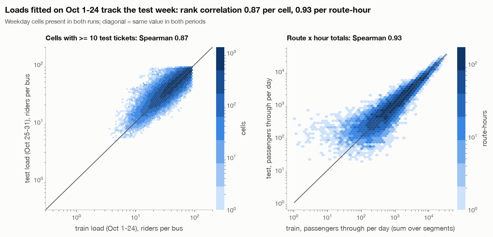
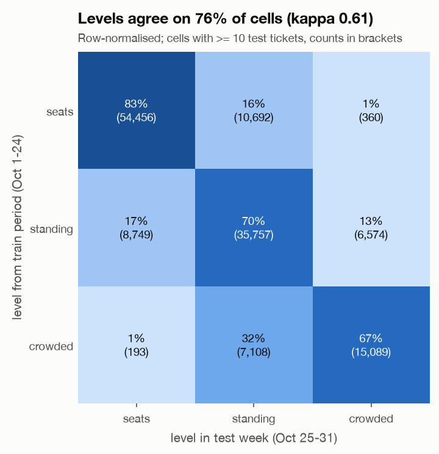

# Week-to-week stability

Train: run `train` (Oct 1-24, 15 weekdays). Test: run `test` (Oct 25-31,
5 weekdays). Both are full model runs on disjoint dates; each is expanded with its own ridership
factor and capacity check. Compared on weekday cells (route pattern x stop-to-stop segment x 30-minute
bin) present in both runs: 1,279,110 of 1,563,485 train and 1,335,866 test cells; the boarding stop of each
segment agrees in 100.00% of joined cells, so cell keys line up.

**Threshold.** The test week has only 5 weekdays, so test estimates are themselves noisy. Headline
numbers use the 138,978 cells with at least **10 kernel-weighted ticketed riders in the
test week** (10.9% of common cells, 30.1% of
their buses). Results for all cells are given below for completeness.

## Headline

- Rank correlation (Spearman) of load, train vs test: **0.87** (all common cells:
  0.83). Within a route (ranking cells of the same route against each other,
  averaged over routes): 0.83.
- Level agreement: **75.8%** of cells (bus-weighted 78.6%),
  Cohen's kappa 0.61. 45.6% of these cells show "seats" in the test week, so raw
  agreement is flattered by the dominant class; kappa corrects for that.
- When the train period says standing or crowded, the test week agrees (standing or crowded) in
  87.8% of cells; of the test-week standing/crowded cells, the train period caught
  85.4%.
- Route x hour totals (passengers through per day summed over a route's segments, 14,695 route-hours with
  >= 10 test tickets): Spearman **0.93**, Pearson on logs
  0.90, median absolute log ratio 0.27
  (about 30% typical difference). Within a route, the hourly
  profile shape correlates at a median Spearman of 0.91
  (889 routes with >= 8 qualifying hours).

## Does time of day add information? Baselines

Each predictor is fitted on the train period and scored on the 138,978 headline cells. "Route all-day
average" predicts every cell of a route with the route's bus-weighted average weekday load; "segment all-day
average" uses the segment's own all-day average (a stronger baseline: it knows where on the route the load
builds up, but not when).

| target | predictor | Spearman | within-route Spearman | MAE (riders) | median abs log ratio | level agreement | kappa |
| :--- | :--- | ---: | ---: | ---: | ---: | ---: | ---: |
| test model | time-of-day model (train) | 0.873 | 0.828 | 7.42 | 0.143 | 75.8% | 0.608 |
| test model | route all-day average (train) | 0.139 | n/a | 20.83 | 0.524 | 46.4% | 0.016 |
| test model | segment all-day average (train) | 0.537 | 0.502 | 16.04 | 0.387 | 52.3% | 0.152 |
| raw test count | time-of-day model (train) | 0.843 | 0.776 | 10.33 | 0.179 | 71.7% | 0.553 |
| raw test count | route all-day average (train) | 0.109 | n/a | 24.78 | 0.570 | 44.2% | 0.013 |
| raw test count | segment all-day average (train) | 0.457 | 0.401 | 20.30 | 0.444 | 47.7% | 0.112 |

The time-of-day model beats the route all-day average
(Spearman 0.87 vs 0.14; mean absolute error 7.4 vs
20.8 riders per bus) and the segment all-day average (Spearman 0.54).
The gap is widest within routes, which is where time of day is the only information: within-route Spearman
0.83 for the model; the route average is a constant within a route, so it
cannot rank cells of the same route at all (its within-route rank correlation is undefined;
the segment average gets 0.50).

Against the raw test count (no shrinkage, so it does not borrow from neighbouring bins or the route), the
model's Spearman is 0.84: lower, because the raw count carries the full Poisson noise of a
few tickets, but the ordering of predictors is the same.

## Confusion matrix of levels (cells with >= 10 test tickets)

| train \ test | seats | standing | crowded |
| :--- | ---: | ---: | ---: |
| seats | 54,456 | 10,692 | 360 |
| standing | 8,749 | 35,757 | 6,574 |
| crowded | 193 | 7,108 | 15,089 |

## By confidence class of the train cell

| train confidence | cells | Spearman | level agreement | kappa | median abs log ratio |
| :--- | ---: | ---: | ---: | ---: | ---: |
| low | 637 | 0.777 | 54.0% | 0.288 | 0.498 |
| medium | 48,336 | 0.873 | 76.6% | 0.577 | 0.182 |
| high | 90,005 | 0.881 | 75.5% | 0.614 | 0.125 |
| low (all common cells) | 943,585 | 0.790 | 92.5% | 0.367 | 0.418 |
| medium (all common cells) | 241,305 | 0.828 | 79.9% | 0.533 | 0.212 |
| high (all common cells) | 94,220 | 0.875 | 75.0% | 0.606 | 0.129 |

Rows without "(all common cells)" are restricted to the headline cells. The weak spot is the small group of
cells that were low confidence in the train period but well observed in the test week: their median absolute
log ratio is 0.50 (a typical factor of 1.6 between periods) and kappa 0.29. These are
cells where the train period had too few tickets to say much, so the estimate was mostly the prior. Medium
and high confidence cells behave alike. Over all common cells, the high agreement of low-confidence cells
(92.5%) only reflects that both periods show "seats" for nearly all of them.

## Agreement against test-week tickets

| test tickets | cells | Spearman model | Spearman route average | Spearman model vs raw | level agreement | kappa | median abs log ratio |
| :--- | ---: | ---: | ---: | ---: | ---: | ---: | ---: |
| 0-1 | 558,974 | 0.773 | 0.261 | 0.426 | 96.3% | 0.239 | 0.499 |
| 1-3 | 308,535 | 0.743 | 0.238 | 0.601 | 88.2% | 0.359 | 0.333 |
| 3-10 | 272,623 | 0.799 | 0.239 | 0.723 | 81.0% | 0.491 | 0.247 |
| 10-20 | 84,563 | 0.848 | 0.158 | 0.810 | 76.0% | 0.567 | 0.171 |
| 20-40 | 39,646 | 0.861 | 0.049 | 0.845 | 74.2% | 0.590 | 0.123 |
| 40-100 | 13,825 | 0.882 | -0.040 | 0.872 | 78.2% | 0.641 | 0.084 |
| 100+ | 944 | 0.892 | -0.273 | 0.877 | 89.9% | 0.776 | 0.039 |

The typical difference between periods (median absolute log ratio) falls from 0.50
in cells with 0-1 test tickets to 0.04 in the best-observed
group, and kappa rises from 0.24 to 0.78. If the crowding pattern had shifted between
the two periods, well-observed cells would disagree about as much as sparse ones; instead disagreement
shrinks as the test week's sample grows, which is what sampling noise produces. Raw level agreement moves
the other way (near 100% in sparse cells) only because sparse cells are almost all "seats" in both periods.

Two cautions on the sparse end. First, in cells with few tickets both periods' estimates lean on the same
kind of prior (the route's level times the city-wide time-of-day shape), so their Spearman of
0.77 at 0-1 tickets partly measures agreement between priors, not
between observations. Second, selecting cells by test-week tickets could favour cells that happened to be busy in
the test week; the effect is small here (median test/train load ratio in the headline set
1.02). Selecting on both periods instead (train >= 30 and
test >= 10 tickets, 116,413 cells) gives Spearman 0.88, level
agreement 76.0% and kappa 0.62.

## Caveats

- Real change between early and late October (festival season, weather) is counted as disagreement
  here; the numbers above include it rather than correct for it.
- Both runs use the same 2025 timetable for supply and the same matching; errors shared by both (missing
  routes, wrong stop matches, a wrong city-wide expansion factor) cannot show up in a train/test comparison.
  This check measures stability, not absolute accuracy.
